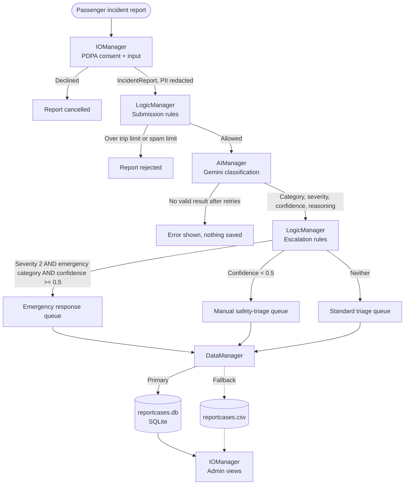
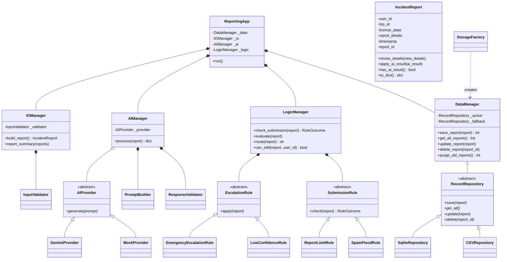

# 26INF1103P5-4 INF1103 Project

## Yapalyzer: An Automated Triage System for Ride-Hailing Reports

> INF1103 – Programming Fundamentals with DevOps · Singapore Institute of Technology · Year 1 Trimester 1 · P5 Group 4

[](https://github.com/ayeitsjonny/26INF1103P5-4/actions/workflows/ci.yml)

---

## Table of Contents

1. [Introduction](#introduction)
2. [Features](#features)
3. [Installation](#installation)
4. [Usage](#usage)
5. [System Design](#system-design)
6. [Object-Oriented Design](#object-oriented-design)
7. [Business Rules](#business-rules)
8. [Data Structure and Storage Design](#data-structure-and-storage-design)
9. [Privacy and Data Protection (PDPA)](#privacy-and-data-protection-pdpa)
10. [Exception Handling Matrix](#exception-handling-matrix)
11. [Testing and Continuous Integration](#testing-and-continuous-integration)
12. [Contributing: Initial Commit Guide](#contributing-initial-commit-guide)
13. [Team](#team)

---

## Introduction

Reports of harassment, abuse and safety violations on ride-hailing platforms such as Grab, Gojek or Tada are on the rise. These reports usually arrive as unstructured free text, and Trust & Safety teams have to review them alongside ordinary customer service complaints. Because severity can't be reliably sorted at intake, high-risk safety threats often get buried in the same queue as minor grievances.

In Singapore, operators carry strict duty-of-care obligations to LTA-licensed drivers and passengers under frameworks like the Protection from Harassment Act (POHA). A delayed or undocumented response is therefore a critical compliance liability, not just an operational inefficiency.

**Yapalyzer** is an AI-driven incident triage system that processes freeform text reports submitted by users. Using automated feature extraction, categorisation and severity scoring, it evaluates incoming text in real time, prioritises urgent safety alerts with reference to POHA's statutory definitions and guidelines, and structures chaotic complaint logs into a sanitised workflow.

It operates across both sides of the platform:

- **Passengers** (User Functions) can file and edit confidential complaints or harassment incident reports.
- **Trust & Safety teams** (Admin Functions) get prioritised safety queues, urgent-attention flags, filters and workload summaries, and can delete reports.

> **Part 2 (OOP refactor):** the Part 1 procedural scripts have been rebuilt as classes. Each manager is now an object, the report itself is an `IncidentReport` object instead of a dictionary, and storage moved from CSV-only to SQLite with an automatic CSV fallback.

## Features

**Reporting (User Functions)**
- PDPA consent notice before any personal data is collected; declining cancels the report
- Guided command-line intake of `user_id`, `trip_id`, `license_plate` plus a multi-line free-text narrative
- Input validation (ID formats, Singapore licence plate format, report length 10–2000 characters)
- Sanitisation of the narrative: control characters stripped, and **NRIC, email and phone numbers redacted** before the text reaches the AI
- Passengers can **edit their own report**; the new text is re-classified by the AI, so a classification never comes from a person

**AI and triage**
- AI classification via the Google Gemini API: category, contact type, stated effect, severity (0–2), confidence (0–1) and written reasoning
- Strict response validation, with automatic retries and backoff when the AI returns something unusable
- Business-rule routing into **emergency escalation**, **manual review / second opinion**, or the **standard queue**
- Submission rules that stop abuse before an AI call is wasted: **max 2 reports per trip per user** and a **spam-flood limit of 5 reports per user in 7 days**

**Admin (Trust & Safety)**
- Display all reports for a Trip ID
- Priority queue view that sorts urgent, high-severity and oldest cases to the top
- Filter reports by severity or category
- Delete a report (with confirmation)

**Storage**
- **SQLite** database (`reportcases.db`) as primary storage, with automatic fallback to **CSV** (`reportcases.csv`) if the database can't be opened or fails mid-run
- Each report has its own auto-generated `report_id`, so a trip can hold more than one report
- **Data retention:** reports older than 180 days are purged automatically at startup

---

## Installation

### Dependencies and Requirements

A `.env` file must be placed in the project root directory, containing a valid API key for Google Gemini. **Without this API key, the program will not run.**

```env
GEMINI_API_KEY=your_api_key_here
```

Python dependencies (installed automatically by Docker) are listed in `requirements.txt`: `pandas`, `python-dotenv`, `google-genai`.

### Manual Docker setup guide

1. Run the following command in the project root directory. (Remember the `.` !)

   ```bash
   docker image build -t <image_name> .
   ```

2. Start the container using the following command. Make sure to use the same image name as above.

   ```bash
   docker run --rm -it --env-file .env -v ./logs_reports:/app/logs_reports <image_name>
   ```

   The `logs_reports` volume keeps the database, CSV and log files on your machine after the container exits.

### Less manual Docker setup guide

1. Run the following to automatically build the image and run the container:

   ```bash
   docker compose run --rm yapalyzer
   ```

---

## Usage

The program starts at a top-level menu that also shows which storage backend is active:

```text
========================================
       AI-ASSISTED SAFETY REPORTING
       Storage: SQLite
========================================
Select Menu:
1. User Functions
2. Admin Functions
3. Quit Program
========================================
```

> The User/Admin split is a proof of concept; there is no login.

### User Functions

| Option | What it does |
| --- | --- |
| **1. Write a report** | Shows the PDPA notice and asks for consent, then prompts for user ID, trip ID and licence plate, then a free-text description (finish with Enter on an empty line). Submission rules are checked, the report is classified by the AI, routed and saved. The new report ID and its queue are shown. |
| **2. Edit my report** | Asks for a report ID and your user ID. If you own the report, you enter a new description, which is re-classified and re-routed before saving. |
| **3. Return to Menu Selection** | Goes back to the top-level menu. |
| **4. Quit Program** | Exits the application. |

### Admin Functions

| Option | What it does |
| --- | --- |
| **1. Display reports from Trip ID** | Shows every stored report for a given trip. |
| **2. Display reports table** | Shows the priority queue, plus counts of cases needing immediate attention or manual review. |
| **3. Filter reports by severity or category** | Shows only reports with a chosen severity (0–2) or category. |
| **4. Delete a report** | Shows the report and asks for confirmation before deleting it permanently. |
| **5. Return to Menu Selection** | Goes back to the top-level menu. |
| **6. Quit Program** | Exits the application. |

### Example: AI-generated reasoning

For a report describing unwanted physical contact from a driver, the AI returns structured reasoning like:

> The report describes unwanted non-consensual physical contact, establishing contact_type as 'physical'. The incident constitutes sexual harassment, which automatically mandates a severity of 2 (high) under the rubric. The emotional response described aligns with 'distress'.

### Example: priority queue

The reports table sorts records by `(immediate_attention_required, severity, timestamp)`. Level 2 is the highest severity and 0 the lowest. Timestamp tie-breakers make sure the **oldest urgent cases are addressed first**.

```text
Incident Report Summary - 8 report(s)
 report_id  user_id  trip_id  license_plate  category          severity  confidence  second_opinion_required  immediate_attention_required  timestamp
         3  user420  trip293  SAB1231V       physical_assault  2         1.0         False                    True                          2026-10-14 14:04:46
 ...
Immediate Attention Needed - 3
Manual Review - 1
```

<!-- TODO: add screenshots from the report appendix, e.g. docs/figure-a1.png -->

---

## System Design

### Project structure

| File | Role |
| --- | --- |
| `main.py` | `ReportingApp`: builds the managers, runs the menu loop and maps each menu option to an action |
| `models.py` | `IncidentReport`: the report object passed between all managers |
| `io_manager.py` | `IOManager`: menus, prompts, PDPA consent and all output |
| `InputValidator.py` | `InputValidator`: regex validation and PII redaction, used by the IO Manager |
| `ai_manager.py` | `AIManager`, `AIProvider` (`GeminiProvider`, `MockProvider`), `PromptBuilder`, `ResponseValidator` |
| `logic_manager.py` | `LogicManager` and the escalation rules |
| `submission_rules.py` | Submission rules (`ReportLimitRule`, `SpamFloodRule`) |
| `data_manager.py` | `DataManager`, `SqliteRepository`, `CSVRepository`, `StorageFactory` |
| `tests/` | Unit tests for all four managers |

### Data flow (writing a report)

| Stage | Class | Responsibility |
| --- | --- | --- |
| 1. Consent and input | `IOManager` + `InputValidator` | Shows the PDPA notice, collects and validates fields, redacts PII, builds an `IncidentReport` |
| 2. Submission rules | `LogicManager` | Rejects the report if the per-trip or spam limit is reached (no AI call made) |
| 3. AI classification | `AIManager` | Builds the prompt, calls Gemini, validates the JSON, retries if needed; result applied with `report.apply_ai_result()` |
| 4. Escalation | `LogicManager` | Sets `immediate_attention_required` / `second_opinion_required` and picks the queue |
| 5. Persistence | `DataManager` | Saves to SQLite (or CSV fallback) and assigns the `report_id` |
| 6. Output | `IOManager` | Confirms the report ID, AI classification and queue |



---

## Object-Oriented Design

### Class diagram



### OOP concepts used

| Concept | Where | How |
| --- | --- | --- |
| **Encapsulation** | `IncidentReport` | Passenger fields (`user_id`, `trip_id`, `license_plate`, `report_details`, `timestamp`) are private with read-only properties. The description can only change through `revise_details()`, which also clears the old AI result so an edited report must be re-classified. |
| **Abstraction** | `AIProvider`, `RecordRepository`, `EscalationRule`, `SubmissionRule` | Abstract base classes define *what* must be done (`generate`, `save`, `apply`, `check`) without saying how. |
| **Inheritance** | `GeminiProvider` / `MockProvider`, `SqliteRepository` / `CSVRepository`, the rule subclasses | Each subclass implements its parent's abstract methods. |
| **Polymorphism** | `AIManager.process()`, `DataManager`, `LogicManager` | The AI Manager calls `generate()` without knowing whether it's Gemini or the mock. The Data Manager calls the same CRUD methods on SQLite or CSV. The Logic Manager loops over a list of rules and calls `apply()` / `check()` on each. |
| **Composition** | `ReportingApp`, `AIManager`, `IOManager` | The app creates and owns the four managers; the AI Manager owns its `PromptBuilder` and `ResponseValidator`; the IO Manager owns its `InputValidator`. |
| **Aggregation** | `AIManager`, `DataManager` | The AI provider and storage repositories are passed in and exist independently, which is what lets tests swap in a mock provider. |
| **Factory** | `StorageFactory` | Hides the "try SQLite first, fall back to CSV" decision from `main.py`. |

---

## Business Rules

### Submission rules (checked before the AI call)

| Rule | Condition | Outcome |
| --- | --- | --- |
| `ReportLimitRule` | User already has 2 reports for this trip | Report rejected with a message |
| `SpamFloodRule` | User has submitted 5 or more reports in the last 7 days | Report rejected; account flagged for suspected spam |

### Escalation and routing (after AI classification)

| Rule / Route | Condition | Queue |
| --- | --- | --- |
| `EmergencyEscalationRule` | Severity = 2 **and** category in `physical_assault`, `sexual_harassment`, `stalking` **and** confidence ≥ 0.5 | Emergency response queue (driver flagged pending review) |
| `LowConfidenceRule` | Confidence < 0.5 | Manual safety-triage queue (second opinion required) |
| Default | Neither of the above | Standard triage queue (normal priority) |

Additional policy: **sexual harassment is always severity 2**, enforced by `ResponseValidator` even if the AI returns a lower value.

### Other rules

- Only the user who submitted a report can edit it (`LogicManager.can_edit`, case-insensitive user ID match).
- A report cannot be evaluated or saved unless it has passed through the AI Manager (`IncidentReport.has_ai_result()`).

---

## Data Structure and Storage Design

### Files used by the application

All files live in `logs_reports/`, which is mounted as a Docker volume.

| File | Purpose |
| --- | --- |
| `reportcases.db` | Primary SQLite database (`reportcases` table). Created automatically on first run. |
| `reportcases.csv` | CSV fallback with the same columns. Used if the database can't be opened at startup, or if it fails during a run. |
| `*.log` | Application and AI Manager logs |

SQLite queries use `?` placeholders, so user input is never inserted into SQL directly (protects against SQL injection). CSV uses UTF-8 encoding.

### Structure of stored records

Column order is defined once in `IncidentReport.FIELDNAMES` and shared by both backends.

| Field | Type | Set by |
| --- | --- | --- |
| `report_id` | int (auto-increment primary key) | Data Manager |
| `timestamp` | datetime (Singapore time, whole seconds) | Auto-captured |
| `trip_id` | str | Passenger |
| `user_id` | str | Passenger |
| `license_plate` | str | Passenger |
| `report_details` | str (PII redacted) | Passenger |
| `category` | str | AI Manager |
| `contact_type` | str (`none` / `verbal` / `physical`) | AI Manager |
| `stated_effect` | str (`none` / `distress` / `fear_for_safety`) | AI Manager |
| `severity` | int (0–2) | AI Manager |
| `confidence` | float (0–1) | AI Manager |
| `reasoning` | str | AI Manager |
| `second_opinion_required` | boolean | Logic Manager |
| `immediate_attention_required` | boolean | Logic Manager |

---

## Privacy and Data Protection (PDPA)

- **Consent:** a personal data notice is shown before any data is collected. If the user declines, nothing is collected.
- **Data minimisation:** NRIC numbers, email addresses and Singapore phone numbers in the description are replaced with `[NRIC]`, `[EMAIL]` and `[PHONE]` before the text is sent to the AI or stored.
- **Retention:** reports older than 180 days are deleted automatically when the program starts.
- **User control:** passengers can edit their own reports; admins can delete reports on request.
- **Secrets:** the API key lives only in `.env`, which is excluded by both `.gitignore` and `.dockerignore`.

---

## Exception Handling Matrix

### I/O Manager

| Exception scenario | Possible cause | Detection method | Handling strategy | User outcome |
| --- | --- | --- | --- | --- |
| Empty input | User inputs blank | `InputValidator.non_empty_input()` | Reject input and retry until valid | User notified that input can't be empty |
| Invalid ID format | Trip/User ID doesn't match `trip123` / `user123` | `InputValidator.trip_id()` / `user_id()` regex | Reject input and retry until valid | User notified of the expected format |
| Invalid licence plate | Doesn't match the Singapore plate format | `InputValidator.license_plate()` regex | Reject and retry; valid plates are normalised (spaces removed, uppercase) | User notified of the expected format |
| Invalid report length | Fewer than 10 or more than 2000 characters | `InputValidator.report_details()` | Reject input and retry until acceptable | User notified of minimum and maximum length |
| Invalid menu / report ID input | Option outside the menu, or report ID not a positive number | `get_menu_choice()`, `get_menu_option()`, `InputValidator.report_id()` | Reject input and request new input | User asked to enter a valid value |
| Malformed input / PII | Control characters, NRIC, email or phone number in the description | `InputValidator.sanitize_report_details()` | Strip control characters, redact PII with placeholders | Not notified; cleaned text is stored |
| Consent declined | User answers "n" to the PDPA notice | `confirm_consent()` | `build_report()` returns `None`; nothing collected | "Report cancelled: consent was not given" |

### AI Manager

| Exception scenario | Possible cause | Detection method | Handling strategy | User outcome |
| --- | --- | --- | --- | --- |
| Missing API key | `.env` missing or `GEMINI_API_KEY` empty | `GeminiProvider.__init__` raises `AIConfigurationError` | Caught in `main.py` | Friendly error message; program exits before showing the menu |
| API failure | Rate limit (429), timeout, network error, wrong model (404), auth error | `GeminiProvider.generate()` catches `APIError` and other exceptions | Logged; returns `None`; `AIManager.process()` retries up to 3 more times with increasing delay | If all attempts fail: "No analysis received from the AI service", nothing saved |
| Malformed AI response | Non-JSON, JSON wrapped in markdown fences, or a JSON list | `ResponseValidator.parse()` regex / `json.JSONDecodeError` / type check | `{...}` block extracted where possible; otherwise logged and retried | Same as above if it never resolves |
| AI response fails validation | Missing key, invalid category/contact type/effect, severity or confidence out of range | `ResponseValidator.validate()` | Logged with the invalid field; retried | Same as above if it never resolves |

### Logic Manager

| Exception scenario | Possible cause | Detection method | Handling strategy | User outcome |
| --- | --- | --- | --- | --- |
| Report has no AI result | Report skipped the AI step | `IncidentReport.has_ai_result()` in `evaluate()` | Raises `ValueError`, caught and logged in `main.py` | Error shown, report not saved |
| Submission limit reached | Too many reports for a trip, or spam flood | `ReportLimitRule` / `SpamFloodRule` | Returns `RuleOutcome(allowed=False)` before any AI call | "Report not accepted" with the reason |
| Unauthorised edit | User ID doesn't match the report's owner | `can_edit()` | Edit refused | "No report with that ID was submitted by this user" |

### Data Manager

| Exception scenario | Possible cause | Detection method | Handling strategy | User outcome |
| --- | --- | --- | --- | --- |
| Database unavailable at startup | Corrupted or unreadable `.db` file, directory can't be created | `sqlite3.Error` / `OSError` wrapped as `StorageUnavailableError` in `StorageFactory` | Start with CSV storage instead | Warning: "Database unavailable - using local CSV storage instead" |
| Database fails during a run | File locked, deleted or corrupted mid-session | `StorageUnavailableError` in any CRUD call | `DataManager` switches to CSV and retries the operation | Warning: "Database error - switched to local CSV storage"; the report is still saved |
| Missing CSV file | Deleted, moved or first run | Path existence check | File recreated with headers | Runs normally without manual setup |
| Corrupt CSV header | Columns edited or file from an old version | Header compared to `IncidentReport.FIELDNAMES` | Old file backed up as `reportcases.corrupt-<timestamp>.csv`, new file started | Runs normally; old data kept in the backup |
| Bad row in CSV | Unconvertible value in a row | `KeyError` / `ValueError` / `TypeError` while loading | Row skipped and logged | Remaining reports display normally |
| Any other storage error | No fallback left | `StorageError` caught in `main.py` | Logged | "Could not access stored reports"; returns to the menu instead of crashing |

---

## Testing and Continuous Integration

### Automated tests

The project uses Python's built-in `unittest` with **65 tests** covering all four managers. The AI is replaced with `MockProvider` and hardcoded sample responses, so the tests run **without a live API connection** and never call Google Gemini.

| Test module | Manager under test | What it verifies |
| --- | --- | --- |
| `test_io_manager.py` | IO Manager | Menu choices and retries, field validation (user/trip ID, licence plate normalisation, report ID), multi-line report details and length limits, PDPA consent (accept and decline), filter choices, priority-queue sorting and record display |
| `test_ai_manager.py` | AI Manager | Response parsing, schema validation, markdown-fenced JSON extraction, the sexual-harassment severity override, retry behaviour, and failure cases (non-JSON, broken JSON, JSON list, missing keys, invalid category/severity/confidence, provider returning `None`) |
| `test_logic_manager.py` | Logic Manager | Refusing reports without an AI result, the multi-condition emergency rule, low-confidence second opinion, standard routing, flag reset on re-evaluation, edit permission, and the report-limit and spam-flood submission rules |
| `test_data_manager.py` | Data Manager | CSV CRUD roundtrip, missing-file recreation, corrupt-header backup, severity/category/trip filtering, and falling back to CSV when the primary storage is unavailable |
| `sample_responses.py` | — | Shared hardcoded AI responses used as test fixtures (no network) |

### Running the tests

Locally, from the project root:

```bash
python -m unittest discover -s tests -p "test_*.py" -v
```

Inside the Docker container (the suite is copied into the image; a dummy key satisfies the environment variable):

```bash
docker build -t <image_name> .
docker run --rm -e GEMINI_API_KEY=test-key-not-used <image_name> \
  python3 -m unittest discover -s tests -p "test_*.py" -v
```

### Continuous Integration

A [GitHub Actions workflow](.github/workflows/ci.yml) runs the test suite automatically on every push and pull request. The workflow:

1. Checks out the repository and sets up Python 3.12.
2. Installs dependencies from `requirements.txt`.
3. Runs `python -m unittest discover -s tests -p "test_*.py" -v`.

Because the tests mock the AI provider, CI uses a dummy `GEMINI_API_KEY` and makes **no live API calls and stores no secret**. The workflow status is shown by the badge at the top of this README and on the repository's **Actions** tab.

---

## Team

**P5 Group 4**

| Member | Role |
| --- | --- |
| Jonathan New Kah Hwee | AI Manager |
| Leong Jun Hong | IO Manager |
| Lee Xin Yuan | Logic Manager |
| Rey Cham (Qin Zhixuan) | Data Manager |
| Jacqueline Goh Jie Ting | Merging and testing |
| Jason Christofer Utomo | Merging and testing |

Repository: <https://github.com/ayeitsjonny/26INF1103P5-4>
