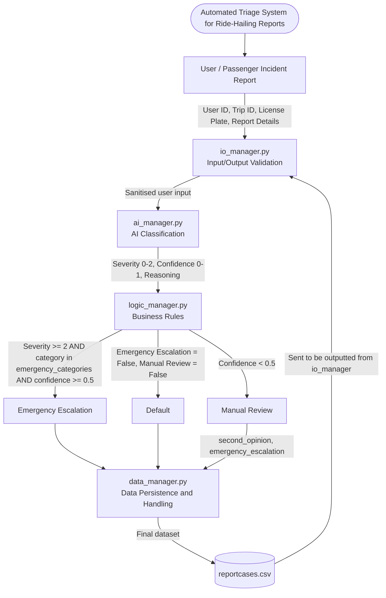

# 26INF1103P5-4 INF1103 Project

## Yapalyzer: An Automated Triage System for Ride-Hailing Reports

> INF1103 – Programming Fundamentals with DevOps · Singapore Institute of Technology · Year 1 Trimester 1 · P5 Group 4

---

## Table of Contents

1. [Introduction](#introduction)
2. [Features](#features)
3. [Installation](#installation)
4. [Usage](#usage)
5. [System Design](#system-design)
6. [Data Structure and Storage Design](#data-structure-and-storage-design)
7. [Exception Handling Matrix](#exception-handling-matrix)
8. [Contributing: Initial Commit Guide](#contributing-initial-commit-guide)
9. [Team](#team)

---

## Introduction

Reports of harassment, abuse and safety violations on ride-hailing platforms such as Grab, Gojek or Tada are on the rise. These reports usually arrive as unstructured free text, and Trust & Safety teams have to review them alongside ordinary customer service complaints. Because severity can't be reliably sorted at intake, high-risk safety threats often get buried in the same queue as minor grievances.

In Singapore, operators carry strict duty-of-care obligations to LTA-licensed drivers and passengers under frameworks like the Protection from Harassment Act (POHA). A delayed or undocumented response is therefore a critical compliance liability, not just an operational inefficiency.

**Yapalyzer** is an AI-driven incident triage system that processes freeform text reports submitted by users. Using automated feature extraction, categorisation and severity scoring, it evaluates incoming text in real time, prioritises urgent safety alerts with reference to POHA's statutory definitions and guidelines, and structures chaotic complaint logs into a sanitised workflow.

It operates across both sides of the platform:

- **Passengers** can file confidential complaints or harassment incident observations from the passenger's seat.
- **Trust & Safety teams** get prioritised safety queues, urgent-attention flags and clear workload summaries.

## Features

- Guided command-line intake of structured metadata (`user_id`, `trip_id`, `license_plate`) plus a free-text narrative
- Input validation and sanitisation (empty input, ID formats, report length, control characters)
- AI classification via the Google Gemini API: category, severity (0–2), confidence (0–1) and written reasoning
- Business-rule routing into **emergency escalation**, **manual review / second opinion**, or the **default queue**
- Flat-file CSV persistence (`reportcases.csv`) with no external database server required
- Priority queue view that sorts urgent, high-severity and oldest cases to the top

---

## Installation

### Dependencies and Requirements

A `.env` file must be placed in the project root directory, containing a valid API key for Google Gemini. **Without this API key, the program will not run.**

```env
GEMINI_API_KEY=your_api_key_here
```

### Manual Docker setup guide

1. Run the following command in the project root directory. (Remember the `.` !)

   ```bash
   docker image build -t <image_name> .
   ```

2. Start the container using the following command. Make sure to use the same image name as above.

   ```bash
   docker run --rm -it --env-file .env -v ./logs_reports:/app/logs_reports <image_name>
   ```

### Less manual Docker setup guide

1. Run the following to automatically build the image and run the container:

   ```bash
   docker compose run --rm yapalyzer
   ```

---

## Usage

The program provides a command-line interface managed by `io_manager.py`:

```text
========================================
        AI-ASSISTED SAFETY REPORTING
========================================
1. Write a report
2. Display a report from Trip ID
3. Display reports table
4. Quit Program
```

| Option | What it does |
| --- | --- |
| **1. Write a report** | Prompts for user ID, trip ID and the incident car's licence plate, then a free-text description of what happened (finish with Enter on an empty line). The report is classified, routed and saved. |
| **2. Display a report from Trip ID** | Looks up and displays the stored report for a given trip. |
| **3. Display reports table** | Shows the priority queue, plus counts of cases needing immediate attention or manual review. |
| **4. Quit Program** | Exits the application. |

### Example: AI-generated reasoning

For a report describing unwanted physical contact from a driver, the AI returns structured reasoning like:

> The report describes unwanted non-consensual physical contact, establishing contact_type as 'physical'. The incident constitutes sexual harassment, which automatically mandates a severity of 2 (high) under the rubric. The emotional response described aligns with 'distress'.

### Example: priority queue

Selecting option 3 sorts records using the columns `(immediate_attention_required, severity, timestamp)`. Level 2 is the highest severity and 0 the lowest. Timestamp tie-breakers make sure the **oldest urgent cases are addressed first**.

```text
Incident Report Summary – 8 report(s)
 user_id  trip_id  license_plate  category           severity  confidence  second_opinion_required  immediate_attention_required  timestamp
 user420  trip293  SAB1231V       physical_assault   2         1.0         False                    True                          2026-10-14 14:04:46
 ...
Immediate Attention Needed – 3
Manual Review – 1
```

<!-- TODO: add screenshots from the report appendix (Figures A.1–A.3), e.g. docs/figure-a1.png -->

---

## System Design

### Data flow

| Stage | Module | Responsibility |
| --- | --- | --- |
| 1. Input and validation | `io_manager.py` | Collects User ID, Trip ID, licence plate and report details; validates and sanitises them |
| 2. AI classification | `ai_manager.py` | Calls Google Gemini; returns severity (0–2), confidence (0–1) and reasoning |
| 3. Business rules | `logic_manager.py` | Routes the report based on severity, category and confidence |
| 4. Persistence | `data_manager.py` | Writes the final record to `reportcases.csv` |
| 5. Output | `io_manager.py` | Reads back from the CSV and displays reports and the priority queue |



### Routing rules

| Route | Condition |
| --- | --- |
| **Emergency escalation** | Severity ≥ 2 **and** category is in `emergency_categories` **and** confidence ≥ 0.5 |
| **Manual review** (second opinion) | Confidence < 0.5 |
| **Default** | Neither of the above |

---

## Data Structure and Storage Design

### Files used by the application

**`reportcases.csv`** is the core persistent data storage layer. It is a structured CSV flat-file database that bridges raw user inputs, AI-driven classification and business-logic routing, without requiring an external SQL database server.

### Data format

Standardised comma-separated values (CSV) using UTF-8, for cross-platform text rendering and dictionary-key row mapping.

### Structure of stored records

| Field | Type |
| --- | --- |
| `timestamp` | datetime |
| `trip_id` | str |
| `user_id` | str |
| `license_plate` | str |
| `report_details` | str |
| `category` | str |
| `contact_type` | str |
| `stated_effect` | str |
| `severity` | int |
| `confidence` | float |
| `reasoning` | str |
| `second_opinion_required` | boolean |
| `immediate_attention_required` | boolean |

---

## Exception Handling Matrix

### I/O Manager

| Exception scenario | Possible cause | Detection method | Handling strategy | User outcome |
| --- | --- | --- | --- | --- |
| Empty input | User inputs blank | `non_empty_input()` | Reject input and retry until valid | User notified that input can't be empty |
| Invalid input | Input doesn't match the required format for Trip/User ID | `validate_user_id()` / `validate_trip_id()` | Reject input and retry until valid | User notified of acceptable input |
| Invalid report length | Fewer than 10 or more than 2000 characters | `validate_report_details()` | Reject input and retry until acceptable | User notified of minimum and maximum report length |
| Invalid menu input | Option outside the available menu options | `get_options()` | Reject input and request new input | User notified of invalid option and asked to enter a valid one |
| Malformed input | Report contains characters such as `\n` or other control characters | `sanitize_report_details()` | Normalise input and remove control characters | User not notified of changes |

### AI Manager

| Exception scenario | Possible cause | Detection method | Handling strategy | User outcome |
| --- | --- | --- | --- | --- |
| API rate limit exceeded | Free-tier rate limit hit | `call_api()` catches `APIError`, status 429 | Switch to next model in list; retry 3× with backoff | Marked `manual_review` if still failing; batch continues |
| Missing API key | Not passed in `docker run` | `_client is None` check at import time | Print an error message about the missing API key | Program exits immediately before processing any rows |
| Model not found | Retired or wrong model name | 404 status in `APIError` | Same retry (won't help, since the name is wrong) | Record routed to manual review; root cause needs a code fix, not a retry |
| Malformed AI response | Non-JSON, or JSON wrapped in markdown fences | `parse_response()` regex finds no `{...}` block, or `json.JSONDecodeError` | Logged via `logging.error`; `process()` retries the whole call | Record routed to manual review if it never resolves |
| AI response fails validation | Value outside allowed list, or missing key | `validate_response()` checks against `VALID_CATEGORIES`, etc. | Logged with the invalid field; `process()` retries | Record routed to manual review if it never resolves |

### Logic Manager

| Exception scenario | Possible cause | Detection method | Handling strategy | User outcome |
| --- | --- | --- | --- | --- |
| Empty/invalid AI output | AI API failure; AI output returns `None` | `validate_Aioutput` function | Returns a `False` boolean to the function for the I/O manager to print | User is told the run failed and returns to the main menu |

### Data Manager

| Exception scenario | Possible cause | Detection method | Handling strategy | User outcome |
| --- | --- | --- | --- | --- |
| Missing or empty storage files | Database files deleted, moved, or freshly initialised (size == 0) | Path existence check via `os.path.exists()` and file size check | Automatically run `initialize_csv()` to recreate files with default headers | Application runs smoothly without manual file setup |
| Missing keys or type mismatches | Incomplete dictionaries from AI, or cross-module type confusion (e.g. int vs str ID) | Safe dictionary `.get(field, "")` calls and explicit `str()` casting during evaluation | Automatically substitute missing values and force string coercion during comparisons | Database queries, updates and filters execute without crashing |

---

## Contributing: Initial Commit Guide

Before you start working on your own section, please do the following:

1. `git pull` to make sure you have the latest version of the repository.

2. `git branch <your_section>`: for `<section>`, input your assigned role. For example, if I'm doing IO Manager, I'll put `git branch io_manager`. This will be the branch you're working on.

3. `git checkout <your_section>`: navigate to your new branch using this command.

4. `git branch`: verify you're on the correct branch. Your output should show something like:

   ```text
     main
   * io_manager
   ```

5. After this, you can start work, and `git add` / `commit` / `push` as you normally would.

6. Once you're done with your work (as in you have **NOTHING** else to add or change), **create a pull request on the GitHub page**.

---

## Team

**P5 Group 4**

- Jacqueline Goh Jie Ting
- Jason Christofer Utomo
- Jonathan New Kah Hwee
- Leong Jun Hong
- Lee Xin Yuan
- Rey Cham (Qin Zhixuan)

Repository: <https://github.com/ayeitsjonny/26INF1103P5-4>
